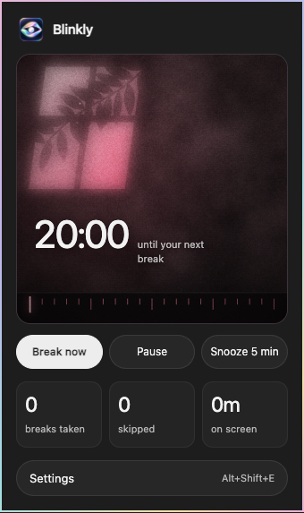

<div align="center">
  
  <h1>Blinkly</h1>
  <p><strong>A small pause for your eyes.</strong></p>
  <p>Every 20 minutes, look 20 feet away for 20 seconds.<br>Quiet reminders, gentle motion, and a voice that knows when to stop.</p>
  <p>
    
    
    
  </p>
  <p>
    <a href="blinkly-chromium.zip?raw=true"><strong>Download for Chromium</strong></a>
    &nbsp; · &nbsp;
    <a href="blinkly-firefox.zip?raw=true"><strong>Download for Firefox</strong></a>
    &nbsp; · &nbsp;
    <a href="https://zxcvresque.github.io/blinkly/">Website</a>
    &nbsp; · &nbsp;
    <a href="#installation">Installation</a>
  </p>
  <p>Created by <a href="https://github.com/zxcvresque">zxcvresque</a></p>
</div>

## A quieter kind of reminder

Window light moves across a textured wall while you work. When it is time to rest, mist clears over a mountain lake. Both scenes follow your actual timer and chosen accent color, with still-frame updates when reduced motion is enabled.

<table>
  <tr>
    <td align="center" width="32%"><a href="design/previews/popup.png"></a></td>
    <td align="center" width="68%"><a href="design/previews/mist-end.png"></a></td>
  </tr>
  <tr>
    <td align="center">Your work rhythm</td>
    <td align="center">A moment to look away</td>
  </tr>
</table>

| Thoughtful by default | Make it yours |
| --- | --- |
| **Gentle breaks** | Adjust work and rest durations, choose a full-screen scene or a corner card, and take a break whenever you need one. |
| **Unhurried voice guidance** | Balanced guidance gives a standard rest two spaced prompts. Quiet mode keeps one opening line. Snooze and Rested responses have separate switches. |
| **230 saved recordings** | Browse named recordings with transcripts and delivery tags. Preview, favorite, mute, search, or filter them. |
| **A personal wind-down** | Set your bedtime and timezone, choose late-night delivery, and optionally shorten reminder intervals near sleep. |
| **Comfort that follows you** | Pick any accent color, switch on a warm tint immediately, and place the floating timer in a corner or drag it into position. |
| **Room for real life** | Quiet hours, pause when away, video deferral, snooze, and optional strict mode keep reminders within your preferences. |

## Installation

### Chrome, Helium, Edge, Brave, and other Chromium browsers

1. [Download the Chromium ZIP](blinkly-chromium.zip?raw=true), extract it, and keep the `blinkly-chromium` folder somewhere permanent.
2. Open your browser's extensions page, such as `chrome://extensions` or `helium://extensions`.
3. Enable **Developer mode**, choose **Load unpacked**, and select the folder containing `manifest.json`.
4. Refresh existing webpages, then pin Blinkly for its countdown badge.

Open **Settings** from the popup to show the panel on your current webpage. Browser settings pages, new-tab pages, and extension stores do not allow the panel; use an ordinary website. Disable duplicate installations so only one copy sends reminders.

### Firefox

1. [Download and extract the Firefox ZIP](blinkly-firefox.zip?raw=true).
2. Open `about:debugging`, choose **This Firefox**, then **Load Temporary Add-on**.
3. Select `manifest.json` inside `blinkly-firefox`, and allow website access if prompted.

Requires Firefox 140 or later. This build is unsigned: temporary installation lasts until Firefox restarts. The Chromium build is tested in Helium; Firefox is packaged but has not been tested in a Firefox runtime. Permanent installation in regular Firefox requires [Mozilla signing](https://extensionworkshop.com/documentation/publish/signing-and-distribution-overview/). It is not an AMO listing.

### Updating an existing installation

Replace the files in the same unpacked folder, reload the extension, and refresh open webpages. Keeping the same installation preserves your settings and history. Installing from a different location can create a separate extension with separate storage.

## Settings that stay with you

| Tab | What you can change |
| --- | --- |
| **Rhythm** | Work interval, break length, heads-up timing, full-screen or corner-card breaks, and strict mode. |
| **Comfort** | Accent swatches or a custom hex color, warm tint strength, **Tint now**, night-only tint, chime, volume, and notifications. |
| **Smart** | Pause when away, wait for video, show or hide the timer, excluded sites, and **Timer placement**. Choose a corner or **Custom · drag on page**. |
| **Sleep** | Bedtime, timezone, wind-down window, quiet hours, and sleepy or playful late-night delivery. **Change voice only** keeps your interval; **More frequent reminders** uses the shorter of your usual and near-bedtime intervals. |
| **Voice** | Guidance volume, **Rest guidance → Balanced / Quiet**, **Snooze response**, **Rested response**, **Speaking to → Male / Female**, optional flirty lines, fact frequency, and a searchable recording library with favorites and muted clips. |
| **Today** | Breaks taken, skipped breaks, screen time, daily streak, and the past week's activity. |

**Tint now** applies warmth immediately, even outside the night schedule. If warmth is set to zero, it starts at 15%. Switching it off restores the night-only schedule when enabled; otherwise the tint turns off.

One shared timer follows you between tabs and browser windows. Pausing, snoozing, restarting, or starting a rest updates every tab and the toolbar countdown together. Only the foreground tab contributes screen time.

Custom timer positions are saved relative to the viewport, shared across tabs, and kept inside the screen when you resize. Your last settings tab, library filters, paused state, statistics, and voice rotation are also remembered locally.

Keyboard shortcuts: **Alt+Shift+E** opens settings, **Alt+Shift+B** starts a break, and **Alt+Shift+P** pauses or resumes.

## A little personality, without the chatter

Balanced guidance uses two prompts, roughly ten seconds apart in a 20-second rest. Quiet mode uses one opening line, and rests shorter than 20 seconds also use one. The later prompt keeps the same pet name or uses neutral wording; it is skipped if the first recording is still playing. An occasional eye fact replaces the opening instead of adding another prompt.

**Snooze response** gives one short reply when you choose Snooze 5 min, from either the page or popup. **Rested response** speaks once at completion and keeps the Rested screen visible until the line finishes. Both are on by default and can be disabled independently. Skip, pause, resume, idle time, and ordinary timer changes stay silent. Leaving the active page stops speech.

**Speaking to** changes how the same narrator addresses you. **Flirty lines** is optional and off by default. When enabled, alerts and rest openings prefer spoken pet names; later guidance keeps the same name or uses neutral wording. Recordings rotate before repeating; favorites are preferred within a matching context, and muted clips stay out of automatic guidance. If every matching clip is muted, that context stays silent. Every recording remains available for manual preview, with only one preview playing at a time.

Voices play through Blinkly's own audio player, so websites cannot block them through their autoplay or media policies. Use **Test voice** to check the selected volume. Switching tabs or leaving the browser stops the current recording; recordings never overlap across tabs.

Quiet hours pause automatic reminders while allowing manual breaks and previews. The chime is a separate setting under Comfort. Desktop notifications are sent by Blinkly through its extension permission; enabling them never asks the current website for notification access.

## Local by design

Recordings ship with the extension. Playback needs no account, API key, generation step, or internet connection. Settings, timer state, preferences, and statistics stay in your browser profile. There are no analytics or runtime speech-service requests.

Reminders work on ordinary HTTP/HTTPS webpages. Browser-owned pages and extension stores restrict content scripts. Each browser profile keeps its own data; only the active tab in the focused browser window can narrate.

## Development

The extension uses plain JavaScript and canvas, with shared Chromium and Firefox sources. No frontend build step is required.

```sh
node --test tests/*.test.cjs
python3 tools/generate_audio.py --assemble-only
python3 tools/package_extension.py
```

The assembly command reuses saved audio without making an API call. Packaging rebuilds both browser variants. Browser QA tools in `tools/verify_*.cjs` use Playwright and a temporary Helium profile; set `PLAYWRIGHT_MODULE` if the module is installed elsewhere.
